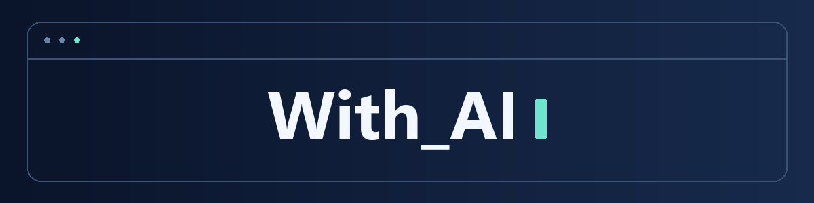

  

<h1 align="center">이 공간은 AI를 활용하며 코딩하기 위한 공간!</h1>

## 작업 바로가기

- [Python 실습](python-practice/)
- [AI 활용 기록](ai-notes/)
- [미니 프로젝트](mini-projects/)

## 최근 학습 기록

| 날짜 | 주제 | 배운 점 |
| --- | --- | --- |
| 2026-11-18 | Git과 GitHub로 학습 저장소 시작하기 | 로컬에서 README를 커밋하고 `git push`로 GitHub에 반영하는 흐름을 익혔다. |
